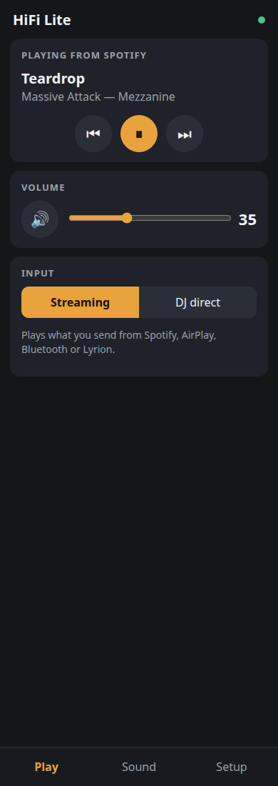
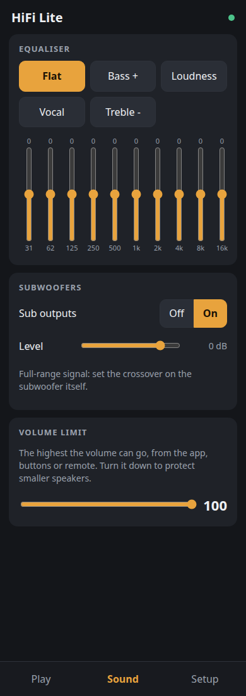
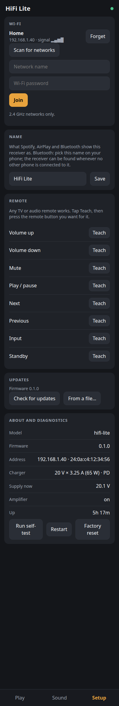
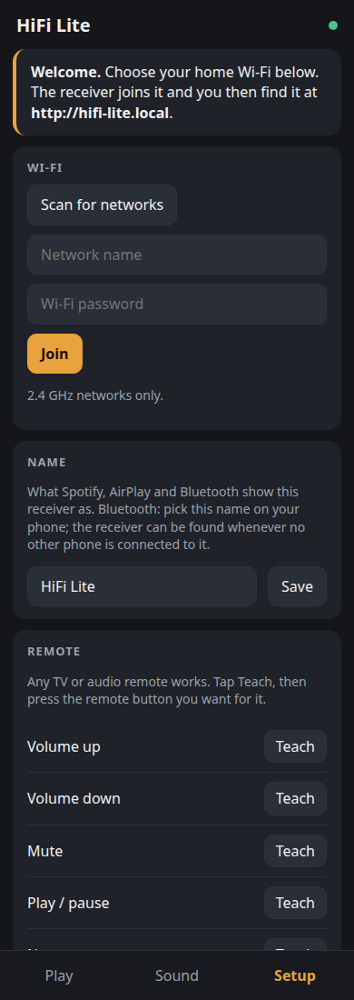
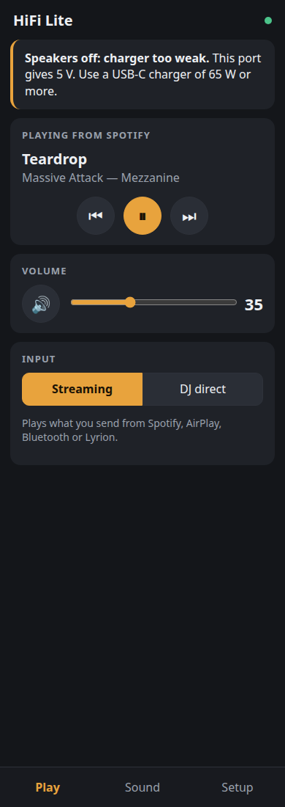
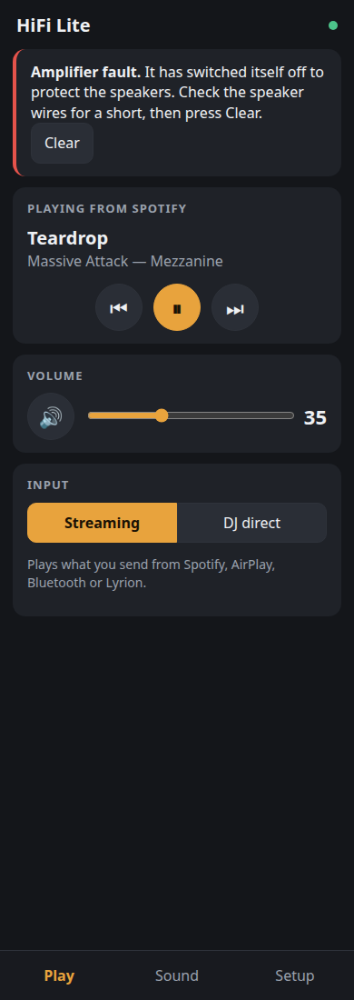
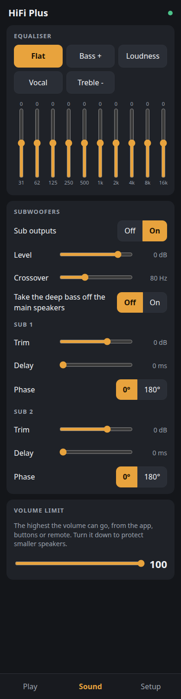
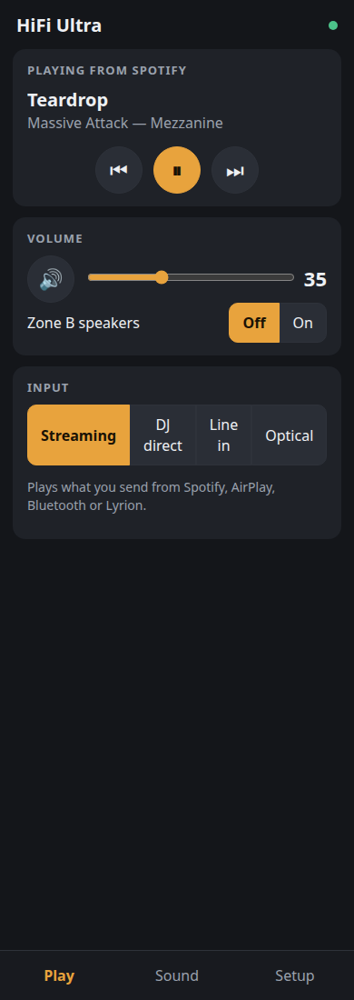

# The web app

The receiver's control app is a web app (a PWA) that the firmware serves from
its own flash. You open `http://hifi-lite.local` (`hifi-plus`, `hifi-ultra`)
or the receiver's IP address in any phone or laptop browser, and on a phone
you add it to the home screen, where it opens full-screen like an app. There
is nothing to download from an app store, no account and no cloud. The same
app serves all three tiers: it reads what the box can do from
`GET /api/v1/info` and shows only those controls.

Plan item 8. The code is in [`app/`](../app):

| Path | What it is |
|---|---|
| `app/web/` | The app itself: `index.html`, `app.js`, `app.css`, the manifest, the service worker and the icons. Plain JavaScript with no framework and no build step, about 36 KB gzipped. |
| `app/mock/server.py` | A mock receiver. It serves `app/web` and answers `/api/v1` the way the firmware does, for Lite, Plus or Ultra, on a good or weak charger, with or without a fault, or in first-run setup. Standard library only. |
| `app/build.py` | Packs the app for the firmware: each file gzipped, plus `webapp_files.c`/`.h`, a table the firmware links in. It fails if the packed app is over 64 KB. |
| `app/tests/test_app.py` | The tests: the API contract, the app's files, the pack, and the app rendered in headless Chrome against the mock. |
| `app/screenshots.py` | Makes the screenshots on this page from the mock. |

## Screenshots

Taken against the mock at an iPhone's width (390 CSS px) by
`python3 app/screenshots.py`.

| Play | Sound | Setup |
|---|---|---|
|  |  |  |

| First run (the receiver's own Wi-Fi) | Laptop port, 5 V | Amplifier fault |
|---|---|---|
|  |  |  |

| Plus: bass management | Ultra: zone B |
|---|---|
|  |  |

## What it does

There are three tabs.

**Play**
- **Now playing:** title, artist and album from Spotify, AirPlay, Bluetooth
  or Lyrion, with previous, play/pause and next.
- **Volume:** a slider and mute.
- **Input:** *Streaming* or *DJ direct*. DJ direct sends the RCA line in
  straight to the amplifier with zero delay, for the FLX4. Plus and Ultra add
  *Line in* (through the ADC, so EQ and the sub settings apply), and Ultra
  adds *Optical*.
- **Zone B (Ultra):** on/off and its own level.

There is no source picker for streams. A stream starts when a phone plays to
the receiver, as with any Spotify Connect or AirPlay speaker. The app shows
what is playing; it doesn't choose it.

**Sound**
- **Equaliser:** 10 bands from 31 Hz to 16 kHz, ±12 dB, with presets: Flat,
  Bass +, Loudness, Vocal and Treble -. These are squeezelite-esp32's own
  10-band EQ.
- **Subwoofers:** on/off and level.
  - **Lite:** sends a full-range signal, so the crossover is set on the sub
    itself.
  - **Plus and Ultra:** add the crossover (40–160 Hz) and "take the deep bass
    off the main speakers". Each sub also gets its own trim, delay
    (0–20 ms) and phase.
- **Volume limit:** the highest the volume can go, from the app, buttons or
  remote.

**Setup**
- **Wi-Fi:** scan, choose, password, join and forget. 2.4 GHz only.
- **Name:** what Spotify, AirPlay and Bluetooth show the receiver as.
- **Remote:** teach any IR remote. Tap Teach next to an action, then press
  the button on the remote. The actions are volume up/down, mute,
  play/pause, next, previous, input and standby.
- **Updates:** check online and install, or upload a `.bin` file.
- **About and diagnostics:** model, firmware, address, the charger's
  contract, supply voltage, amplifier state, temperature (Plus/Ultra) and
  uptime.
  - **Run self-test:** the firmware's self-test, with each check named in
    plain words.
  - **Restart** and **Factory reset**.

**Notices** sit at the top of Play when something needs the user:
- **"Speakers off: charger too weak":** a 5 V port, so the amplifier is held
  off.
- **"Speakers off: the supply is out of range":** under- or over-voltage.
- **"Power limit. Turned down X dB…":** the governor is limiting.
- **"Amplifier fault…":** a latched fault, with a Clear button.
- **"Looking for the receiver…":** shown when the receiver can't be reached.

## First run

The receiver doesn't know the Wi-Fi yet, so it makes its own network,
`HiFi-XXXX`.
1. The phone joins it, and the captive portal opens the app at
   `http://192.168.4.1`.
2. The app sees `net.mode == "ap"` and opens on Setup with a welcome note.
3. The user scans, chooses the home network and types the password.
4. The receiver joins while keeping its own network up, and reports the
   result in `net.join`.
5. The app says "Joined Home. Reconnect this phone to it and open
   http://hifi-lite.local".

A wrong password shows "Could not join Home: wrong password" and the user can
try again. Nothing is lost, because the receiver's own network stays up.

## Installing on a phone

- **iPhone (Safari):** Share → **Add to Home Screen**. It opens full-screen
  with the HiFi icon (from `apple-mobile-web-app-capable` and the 180 px
  touch icon).
- **Android (Chrome):** menu → **Add to Home screen**. Chrome makes a
  home-screen shortcut.

**The honest limit:** Chrome's full "Install app" and the service worker
(the offline shell) need a secure origin, meaning https or localhost. A box
on a home LAN at `http://hifi-lite.local` can't have a certificate a phone
trusts. So on the receiver itself:
- the app works the same on every platform;
- Android's icon is a shortcut that opens in a Chrome tab rather than its
  own window;
- the service worker only registers on https.

**Rejected: hosting the app on an https site** (for example GitHub Pages)
and having it talk to the box. The browser blocks an https page from calling
an http device (mixed content). A native wrapper (Capacitor) is the way past
this if it ever matters. The app's code would carry over as it is.

## The API

The app speaks only the firmware's `/api/v1`. That API is documented in
[test-api.md](test-api.md), which the firmware worker owns. The app uses its
`info`, `state`, `input`, `sub`, `amp`, `control` and `selftest` calls as they
are written there. It also needs the calls below; they were sent to the
firmware worker (task 261028-165619) on 2026-10-28 to add to test-api.md.
Every one of them replies with the full `GET state`, so the app redraws from
one reply. `app/mock/server.py` implements all of it, and is the reference
until the firmware does.

**In the firmware now** (task 261028-201030, [test-api.md](test-api.md)):
`audio.volume`, `mute`, `max_volume`, `audio.playing`, `ir`, `POST volume`,
`POST ir/learn` and `POST ir/forget`, as below. The mock follows the
firmware's rules for them: a volume outside 0–100 is a 400, not clamped.

**`GET info` adds:**
- `name`: the player name.
- `caps`: what the board can do.

```json
"caps": {"line_modes": ["dj_direct"], "eq_bands": [31, 62, 125, 250, 500, 1000, 2000, 4000, 8000, 16000],
         "eq_min": -12, "eq_max": 12, "sub": {"count": 2, "crossover": false, "per_sub": false},
         "zones": 1, "eth": false, "pdo_v_max": 20}
```

On Plus, `line_modes` is `["dj_direct", "line"]`, and `crossover` and
`per_sub` are `true`. Ultra adds `"optical"` and `zones: 2`.

**`GET state` adds:**

| Field | Values |
|---|---|
| `audio.volume` | 0–100 |
| `audio.mute` | bool |
| `audio.max_volume` | 30–100 |
| `audio.eq` | 10 gains in dB |
| `audio.sub` | `{on, level_db}`, plus `xover_hz`, `mains_hp` and `subs: [{trim_db, delay_ms, invert}]` where caps say so |
| `audio.playing` | `{state: "play"\|"pause"\|"stop", title, artist, album, elapsed_s, duration_s}` or `null`; for Lyrion the text is `null` |
| `audio.zone_b` | `{on, volume}` (Ultra) |
| `net.mode` | `sta` or `ap` |
| `net.ssid`, `net.hostname`, `net.eth` | the network it is on, its name, and whether Ethernet is connected |
| `net.join` | `{ssid, state: "joining"\|"ok"\|"failed", ip, reason}` |
| `update` | `{state: "idle"\|"downloading"\|"flashing"\|"done"\|"error", progress, error}` |
| `ir` | `{learning: <action>\|null, learned: [<action>…], last_code}` |

**Writes:**

| Call | Body |
|---|---|
| `POST volume` | `{volume?, mute?, max_volume?}` |
| `POST eq` | `{gains: [10]}` |
| `POST sub` | `{on?, level_db?, xover_hz?, mains_hp?}`, or `{sub: i, trim_db?, delay_ms?, invert?}` for one sub |
| `POST zone` | `{zone: "b", on?, volume?}` |
| `POST name` | `{name}` (1–32 characters) |
| `GET wifi/scan` | replies `{networks: [{ssid, rssi, secure}]}` |
| `POST wifi` | `{ssid, password}` |
| `POST wifi/forget` | |
| `POST ir/learn` | `{action}`: the next IR code the receiver sees is bound to that action |
| `POST ir/forget` | `{}` for all, or `{action}` for one |
| `GET update/check` | replies `{current, latest, url, notes}`; optional |
| `POST update` | `{url}` |
| `POST update/upload` | a raw `.bin` body |
| `POST reboot` | |
| `POST reset` | `{factory: true}` |

If `update/check` returns 404, the app offers only "From a file".

**Self-test labels:** the app maps the firmware's check names to plain labels
(`pd_sink_i2c` → "Charger chip", and so on), so those names should stay
stable.

**What was dropped from the first draft, and why:**
- **A source picker.** squeezelite-esp32 can't start Spotify or AirPlay from
  the box.
- **A Bluetooth pair button.** The sink is discoverable whenever no phone is
  connected, so the Name card says that instead.
- **Lite's "through EQ" line-in mode.** The Lite firmware routes the line in
  only through the ES8388's analog bypass.

### How the firmware serves it

- **Build:** `python3 app/build.py` writes `app/dist/webapp_files.c` and
  `app/dist/webapp_files.h`. The firmware compiles them in.
- **Paths:** for each request path it finds the entry and sends `data` with
  `Content-Type: <content_type>`, `Content-Encoding: gzip` and
  `Cache-Control: no-cache`. `/` is `/index.html`.
- **The app replaces squeezelite-esp32's own UI at `/`.** That UI stays
  reachable at `/squeezelite/` for advanced settings.
- **Or a filesystem:** `app/dist/www/*.gz` are the same files, for a
  LittleFS image if the firmware would rather use one.
- **Size:** about 36 KB packed, against a 64 KB budget that `build.py`
  enforces. The icons are half of it.

## Develop and test

```sh
python3 app/mock/server.py --model lite        # http://127.0.0.1:8080/
python3 app/mock/server.py --ap                # first-run setup
python3 app/mock/server.py --pdo 5x3           # a laptop port: amp off
python3 app/mock/server.py --model ultra --fault
python3 app/tests/test_app.py                  # all tests; the browser ones need Chrome
python3 app/build.py                           # pack for the firmware
python3 app/screenshots.py                     # refresh the screenshots above
```

To try it on a real phone, run the mock with `--host 0.0.0.0` on a laptop on
the same Wi-Fi and open the laptop's address on port 8080.

Against a real board, open the board's address. The app is same-origin, so
nothing needs configuring.

**Tested:** the API contract on all three models; every file the app
references exists; `node --check` on the JS; the pack is under budget, the
same bytes every time, and compiles with `cc -Wall -Werror`; and in headless
Chrome against the mock, the Play page, first-run setup, the Setup page and
the weak-charger notice.

**Not tested yet:** a real board (the firmware's API isn't built yet), a
real iPhone or Android phone, and a captive-portal mini-browser.
