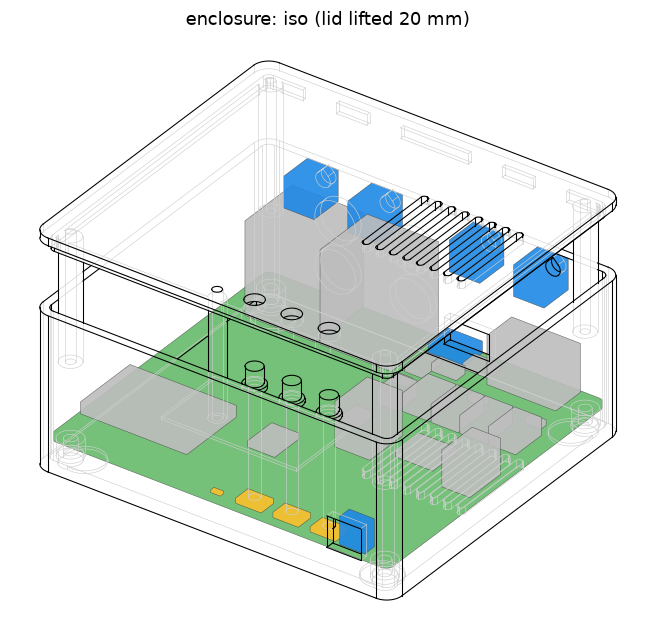

# Enclosures

3D-printable enclosures for the receiver, made in code (build123d), fitted
to the boards' KiCad files, and exported as STEP and STL. All three tiers
are read, built, rendered and fit-checked with hive-mech's `mech`: each tier
is a `mech build` script (`lite.py`, `plus.py`, `ultra.py`), and the pieces
they share (screws from below into lid pillars, RCA holes, binding posts,
Lite's banana-socket holes, light pipes) are in `core_box.py`.

The brief asked for Onshape. The Hive has no Onshape account or key (nothing
in `/hive/tools` or the knowledge base), so the model is code in this repo.
STEP moves it to Onshape later (see the end of this page).

## Lite



- **Box:** 124 x 96 x 39.8 mm: a base (the tray), a lid and three printed
  buttons.
- **Files:** `out/lite/base.stl`, `lid.stl` and `btn_SW1-3.stl` are already
  in print orientation. `out/lite/enclosure.step` is the assembly with the
  board as a slab, for Onshape.
- **Fit:** `out/lite/fit.md` is the fit check's report against the board.
- **Material:** about 110 g if printed solid, so about $2–3 of filament.

### Printing

- **Material:** PETG or ASA, not PLA. The amp heats the inside, and PLA
  softens at about 55 °C.
- **Settings:** 0.4 mm nozzle, 0.2 mm layers, 4 walls, 20–25 % infill.
- **No supports.** The base prints on its floor, the lid on its top face and
  each button on its cap. The holes in the walls are teardrops (RCA: cut
  flat 1 mm over the hole, a 3 mm bridge), squares with a 45-degree roof (the
  banana sockets) or bridge (USB-C, IR window). Each standoff has a 7.8 mm foot round its 6.2 mm
  counterbore, so the ring left round it is two nozzle lines. The foot joins
  the wall beside it.
- **Bed:** both parts fit a 220 x 220 mm bed.

### What else it needs

| Item | Qty | Note |
|---|---|---|
| M3 x 12 screw, socket or pan head | 4 | Threads straight into the lid's pillars (2.5 mm pilot), no inserts. |
| Rubber foot, ≤ 11 mm dia | 4 | Self-adhesive. The underside has 0.8 mm recesses for them. |

### Assembly

1. Drop the board onto the four standoffs, with its connectors to the rear
   wall: tilt it nose-first so the four banana sockets' round collars go into
   their square holes, then lay it down. The RCA and USB-C sockets line up
   with their holes. There is no wiring: the speaker sockets are on the board.
2. Drop the three buttons into their holes in the lid from underneath, cap
   up, then put the lid on, holding them in. Its lip locates it inside the
   walls.
3. Fit the four screws from underneath. Each one goes through the base and
   the board's mounting hole into a lid pillar. Together they clamp the board
   and hold the lid. Don't overtighten them: the thread is plastic.

### Panels

- **Rear, seen from behind, left to right:**
  - the speaker outputs, four 4 mm banana sockets low down at 11 mm pitch,
    7.5 mm over the board: R- R+ (right speaker) then L- L+ (left speaker).
    Red is +, black is -. Single banana plugs; a dual (19 mm) plug doesn't fit.
  - USB-C power, low down
  - SUB OUT, an RCA pair
  - LINE IN, an RCA pair, for the FLX4

  In each RCA pair the upper jack is left (white) and the lower one is right
  (red).
- **Front:** a window for the remote, at the bottom right seen from the
  front. Behind it is the IRM-3638T receiver, with its lens facing forward.
- **Top:**
  - three buttons along the front edge, left to right: vol−, vol+ and
    play/source (hold for Bluetooth pairing). Each is a printed plunger: a
    4.6 mm cap through the lid, a flange under the lid that keeps it in,
    and a stem down to 0.3 mm over its switch.
  - the status LED's light pipe, to the left of the buttons
  - vent slots over the amplifier. Keep them uncovered.
- **Underside:** floor vents under the amplifier and the four feet. No label
  recess: its roof would be a 22 mm bridge off the bed.

There are no embossed labels yet: build123d's text needs a font this machine
doesn't have set up. Until then, use a printed sticker.

### How it is fitted

`lite.py` places every feature from `lite-main.board.json` (mech's read of
the board), so a moved hole or connector moves its cut-out. It is in mech's
board frame: x along the front edge, y back (the rear wall is the N edge),
z = 0 the board's bottom face. The dimensions behind it:

| | mm | why |
|---|---|---|
| Wall | 2.4 | 6 perimeters |
| Floor | 2.0 | |
| Lid | 2.2 | |
| Board edge to wall | 0.6 | |
| Standoff | 5.0 | RCA pins stick out 2.9 mm under the board |
| Board top to lid | 29.0 | RCA pair 27 mm tall, and 2 mm over it |
| RCA holes | 12.0 | a plug's outer shell, over the 8.3 mm barrel |
| USB-C opening | 13.4 x 7.6 | mech's USB-C plug (12.4 x 6.6) + 0.5 a side |
| IR window | 9 x 8 | round the lens, 5 mm over the board |
| Banana-socket holes | 10.2 round, teardrop roof | the sockets' 9.5 mm round collar (Amass drawing; it reaches 2.65 mm past the board edge, into the wall) + 0.3 a side |

Before mech's check sees the board, `lite.py` cuts the RCA jacks to their
body inside the rear wall with a port per barrel, cuts the banana sockets
(J4-J7) the same way with their square nose as the port, and makes U9's lens
a port through the front wall.

Part heights come from `heights.json`: the parts' STEP models and LCSC's
seated heights. The stacked-RCA model in the board library sits 13.5 mm too
low and 6.1 mm too far in, so its heights are corrected by hand. Barrel axes
are 6.5 and 20.5 mm above the board. A footprint not in `heights.json` gets
mech's height (its 3D model, the name, a package table, else 5 mm with a
warning).

### Rebuild and check

```sh
M=$HIVE_MODULES/hive-mech/bin/mech           # builds its venv in ~/.cache/mech on first use
$M board boards/lite-main/kicad/lite-main.kicad_pcb --heights enclosure/heights.json -o enclosure/lite-main.board.json
$M build enclosure/lite.py -o enclosure/out/lite     # STL, STEP, renders; exit 1 on a fit failure
python3 enclosure/fit_md.py lite
```

mech's checks (see its `docs/README.md`): the board and every part's box
(with through-hole leads under the board) clear the plastic; base, lid and
buttons don't overlap; each plug's opening (USB-C, each RCA barrel, each
post) and the IR window are open straight out through the wall; the board
is held under each mounting hole; every part fits a 220 x 220 mm bed.
`fit_md.py` adds that the post boxes clear the board's own parts.

## Plus and Ultra

Both are fitted to the routed `core` board (`boards/core`, main at 18ceb29).
They are built by `plus.py` and `ultra.py`, which call `core_box.py`.

| | Plus | Ultra |
|---|---|---|
| Outside, without knob | 132.4 x 112.4 x 39.8 mm | 135.4 x 114.4 x 49.2 mm, plus a 4.2 mm control column on the front |
| Printed parts | base, lid, knob, 2 buttons | base, lid, knob, 3 buttons |
| PETG if solid | about 134 g | about 146 g |
| Fit check | `out/plus/fit.md`, 40/40 | `out/ultra/fit.md`, 50/50, printing without support included |

Each `out/<tier>/` folder holds the STLs (already in print orientation),
`enclosure.step` (the assembly with the board as a slab, for Onshape), the
fit report and renders (`iso.png`, `top.png`, `port-<edge>.png`).

### What is where (board frame: N = rear, S = front, W = left seen from the front)

- **Rear (N):**
  - the speaker binding posts, at 19 mm pitch within each pair so dual
    banana plugs fit. From the left, seen from the front: L pair, then R
    pair. Inside, each post wires to a screw terminal on the board:

    | Posts | Plus | Ultra (lower row) | Ultra (upper row) |
    |---|---|---|---|
    | L pair (x 11.2, 30.2) | zone A, **J6** | zone A, J6/J7 | zone B, J10/J11 |
    | R pair (x 41.4, 60.4) | zone B, **J11** | zone A, J6/J7 | zone B, J10/J11 |

    Plus fits both amps, one per channel (task 261029-075354, PR #68): L on
    zone A's J6, R on zone B's J11, which sits right under the R pair, so
    its wires are the shortest. On a board that still has zone B unfitted
    (main's `boards/core/parts/parts.json` before PR #68 lands), the R pair
    wires to J7 instead.
  - SUB OUT (J4) and LINE IN (J5), a 12 mm teardrop hole per barrel.
  - Ultra adds TOSLINK (U19) and a second row of posts for zone B
    (J10/J11) above zone A's.
- **Left (W):** USB-C power (J1) and Ethernet (J2).
- **Top, Plus:** the volume knob, with a long printed stem down to the core's
  vertical EC11 (SW1). Also two buttons (SW2, SW3), a light pipe over the
  status LED (D3) and a 9 mm IR hole over U18. The lid grille sits over the
  amplifiers (see Heat).
- **Front, Plus:** an IR window in front of U18.
- **Front, Ultra:** the `ultra-front` board stands behind the front wall,
  face forward. Its J1 sits 4.1 mm in front of the core's J3, and its
  bottom edge is 4.4 mm over the floor, which leaves room for the FFC to
  turn under it. The panel has:
  - **Screen:** a window over the LCD, active area + 1 mm a side, its
    sides opening at 45 degrees on a flat sill. It is a slot up to the
    wall's top: a tab on the lid drops into it and is the window's top
    edge (1 mm flat, then opening at 45 degrees). The LCD's face is 2.7 mm
    behind the panel's outside.
  - **Buttons:** three plungers (SW1-3). Each has a cap through the wall
    and a flange behind it, which the board holds captive. Each prints
    standing on the flange's flat back, cap up.
  - **Control column:** a raised column on the right with a pocket for the
    EC11 body and the IR receiver. It carries the knob (on the EC11's M7
    bushing, through a teardrop hole), the IR window and the RGB LED's
    hole. The pocket opens up under the lid, and in front of the wall its
    roof rises at 45 degrees.
  - **Mounting:** the front board screws to four bosses on the wall with
    M2.5 x 6 thread-forming screws from behind. Fit it **before** the core.
  - **Core LED:** Ultra keeps the top light pipe for the core's D3.
- **Heat: the box is a chimney** (`core_box.vent_plan`, task
  261030-074523). Air comes in low, rises past the board's edges and leaves
  through the lid, about 1500 mm² open at each stage, as
  docs/review-2/thermal.md 6.2 asks. The board fills the box, so without a
  riser past it the old floor and lid slots breathed through only the
  0.6-2 mm edge gaps (~95 mm² in series).

  | open area, mm² | Plus | Ultra |
  |---|---|---|
  | inlet: low wall slots (2 mm wide, from 0.5 mm over the floor) | 61 slots x 10.5 mm on S, E, W: 1281 | 35 x 15 mm on E, W: 1050 |
  | inlet: floor slots in the riser strips, clear of the feet | 45: 449 | 46: 466 |
  | riser: board edge to wall, less what stands in it | S 7 mm + E 7 mm: 1565 | behind the front board 4.8 mm + E 10 mm: 1578 |
  | outlet: lid grille (17 slots 2 x 42 mm over both amps) + slots over the E strip | 1598 | 1736 |
  | stack, inlet middle to lid top | 32 mm | 39 mm |

  - **What it buys (hwde check_thermal's box model, ±30 %):** Plus's air at
    5 W inside in a 30 C room drops from ~64 C to ~49 C, so PETG's Tg
    margin goes from 16 K to 31 K. At 10 W it is ~62 C (was ~95 C).
    Ultra's is ~60 C at 10 W and ~69 C at 14 W (its 1/8-power heat). The
    amps' governor can rise to match (heatsink-options.md, PR #68). The
    numbers go in core's constraints `enclosure` block with PR #68, which
    adds it: Plus box_mm [132.4, 112.4, 39.8], inlet 1730, riser 1565,
    outlet 1598, stack 32.
  - **Room it costs:** the 7 mm riser strips make Plus 5 mm wider and 6.4
    mm deeper, and Ultra 8 mm wider. Plus's IR window (U18) is now 9.9 mm
    in from the front face (the fit check allows it 11; it is seen, not
    plugged, and the front-facing receiver is an open point below).
  - **Feet:** a foot whose recess would leave a web under 1 mm to a
    screw's counterbore moves 1-3 mm along its diagonal (`feet()`).
  - **Printing:** every vent is a 2 mm slot. The wall slots' tops are 2 mm
    bridges, and the floor and lid slots are holes in the first layers.
  - **Heatsink room:** each fitted TPA3221's top slug still has 19 x 12 mm,
    up to 1 mm under the lid (`HS_U15`, `HS_U16` in the fit check), under
    the grille. The floor slots under each amp stay. With PR #68's
    pad-down TPA3220 nothing goes there.
  - **Keep it clear:** the inlets are on the sides and front, near the
    bottom, so the box wants its feet on a hard surface, not on a cloth.
- **Screws, feet:** 4 x M3 x 12 screws go up from underneath, through the
  base and the board's holes, into the lid's pillars (as on Lite), plus 4
  rubber feet of 11 mm or less.

### The FFC (Ultra)

You need a 20-pin, 0.5 mm FFC, 30-50 mm long, of **type B (opposite-side
contacts)**:

- **Why type B:** J3 on the core and J1 on ultra-front are the same
  bottom-contact socket. The cable leaves J3 flat with its contacts facing
  down. It then turns down, runs forward under the front board and turns up
  into J1, whose contacts face the board (toward the rear). Over that path
  the contact face turns from down to forward-facing, so the far end needs
  its contacts on the other side.
- **Pin mapping:** the cable doesn't twist, and both sockets are at
  rotation 0, so pin N meets pin N. That is what ultra-front's README
  requires.
- **Don't fit a type A (same-side) cable** (review-5 R5-UF-5). It's the
  common default. As inserted it makes no contact; with one end flipped it
  maps pin N to 21-N, which puts core's LCD_BL push-pull output on front GND
  (pin 11) and GPIO32 (FFC_SCK) on ENC_A, which is GND whenever the knob
  rests with A closed: an output shorted for as long as it drives high.
- **What to order:** search for "FFC 0.5 mm 20P 50 mm reverse" (also sold
  as "type B" or "opposite side"); check the listing says reverse/opposite
  contacts, not "same side". On LCSC, BXCONN's FC0.5-xxP-050-...-B family
  is reverse-contact 50 mm (the 24-pin one is C53207182); LX's FFC20P parts
  there are same-side. The route needs about 25-30 mm (J3 mouth to the
  board back 4.1 mm, ~4 mm down, 1.6 mm under, 1.8 mm up, 2 x 3 mm
  inserted), so 50 mm leaves slack; don't go past 50 mm.

### What the box adds to the board before the fit check

`core_box.prepare` changes the board that mech's check sees:

- **Dropped:** parts the tier doesn't fit (from `boards/core/parts/parts*.json`).
- **RCA jacks:** J4/J5 are cut to their body inside the rear wall. Their
  barrels are checked as ports through the round holes.
- **Added as boxes:** the binding-post nuts and lugs, the heatsinks, and
  for Ultra the front board, its parts and the LCD.
- **Plus SW1:** counts as the EC11's body and bushing. Its shaft runs up
  the knob's bore.
- **Not ports:** the screw terminals and the FFC are internal.

`fit_md.py` also checks that those added boxes clear the core's own parts,
which mech doesn't.

Part heights for core and ultra-front are in `heights.json`. They come from
LCSC (470 µF 10x20, KF301), the boards' own `lib/aiee.3dshapes` models
(RJ45, PLR237, EC11, PCC-M0854M) or the part names.

### Rebuild and check

```sh
M=$HIVE_MODULES/hive-mech/bin/mech           # builds its venv in ~/.cache/mech on first use
$M board boards/core/kicad/core.kicad_pcb --heights enclosure/heights.json -o enclosure/core.board.json
$M board boards/ultra-front/kicad/ultra-front.kicad_pcb \
   --heights enclosure/heights.json -o enclosure/ultra-front.board.json
$M build enclosure/plus.py  -o enclosure/out/plus     # exit 1 on a fit failure
$M build enclosure/ultra.py -o enclosure/out/ultra
python3 enclosure/fit_md.py plus ultra
```

`ultra-front.board.json` was read from the ultra-front task's branch (PR #10)
and re-read on its merge with main: the board as landed gives the same file.

### Open points (Plus/Ultra)

- **Plus IR:** U18 (IRM-H638T) looks up and sits about 25 mm under the
  lid. Neither the lid hole nor the front window gives it a remote's view
  from across a room. The fix belongs to the board: a front-facing THT
  IRM-3638T at the front edge, as Lite has. The core review
  (task 261029-020622) is taking it, and the box is re-cut when it lands.
- **RCA pegs:** core's RCA footprint lacks the jack's two locating-peg
  holes, which Lite's has. Also in that review.
- **Heatsink fixing:** the board has no heatsink holes, though
  `architecture/blocks.md` plans them. Until it has them, the heatsink is
  stuck on with tape. 19 x 12 mm is the room there is before the output
  inductors. That is enough for music (about 3 W) but not for long
  full-power sine tests.
- **Unchecked dimensions:**
  - the LCD's active-area offset in its module (datasheet p.10). The
    window is centred with 1 mm a side to spare.
  - the EC11 shaft length: Alps lists 20 mm, the library model 24.5 mm.
    Both knobs' bores take either; push the knob on until it stops.
- **Tight post spacing:** the posts between pairs are 11.2 mm apart, the
  most room there is between H1's pillar and J4.

## Moving it to Onshape

Import `out/<tier>/enclosure.step` into a Part Studio (Import, then "Create
a Part Studio"). It comes in as solid parts, ready to edit by hand or to make
drawings from. `mech onshape` uploads it once the person gives an API key
(hive-mech's `docs/onshape.md`). The code here stays the source:

- **Board change:** if the board changes, regenerate here and re-import.
- **Edits in Onshape:** export them as STEP and record what changed in
  `lite.py`, `plus.py`, `ultra.py` or `core_box.py`.
- **Access:** an Onshape account or API key is the person's to give. It never
  goes in a file here.

## Open points

- **Button stems are long:** each Lite button is 37 mm tall with a 3 mm
  stem, printed standing on its cap. That is printable, but untested. If it
  wobbles, print it slower or add a brim.
- **Board snapshot:** `lite-main.board.json` is read by `mech board` from
  the committed, routed `boards/lite-main` (main at fe17345, 2026-10-29).
  Re-run the commands above whenever the board changes.
- **Labels:** none yet (see Panels).
