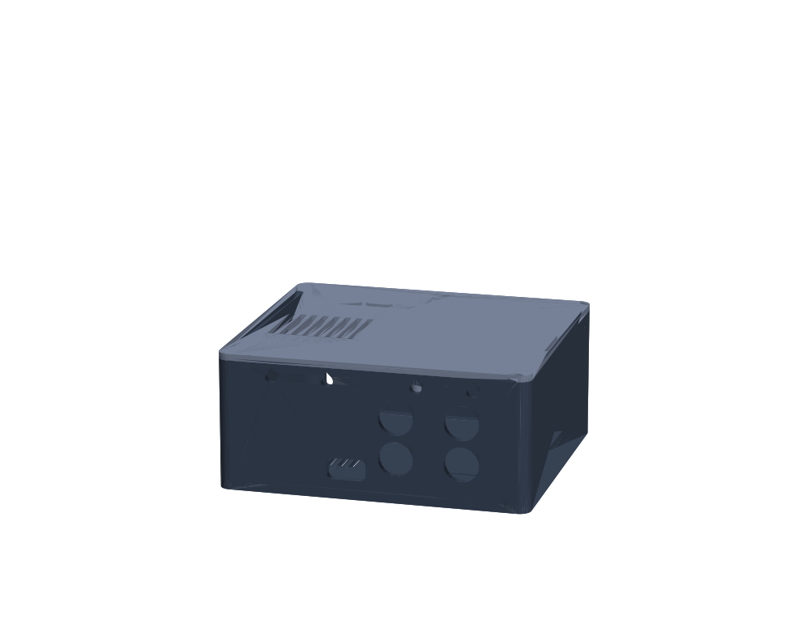

# Enclosures

3D-printable enclosures for the receiver, made in code (build123d), fitted
to the boards' KiCad files, and exported as STEP and STL. Lite is done here;
Plus and Ultra come when the `core` board is placed.

The brief asked for Onshape. The Hive has no Onshape account or key (nothing
in `/hive/tools` or the knowledge base), so the model is code in this repo.
STEP moves it to Onshape later (see the end of this page).

## Lite



- **Box:** 106 x 96 x 46.8 mm, in two printed parts: `lite-base` (the tray)
  and `lite-lid`.
- **Files:** `out/lite/lite-base.stl` and `out/lite/lite-lid.stl` are already
  in print orientation. `out/lite/*.step` are in the assembled position.
- **Fit:** `out/lite/fit.md` is the fit check's report against the board.
- **Material:** about 107 g if printed solid, so about $2–3 of filament.

### Printing

- **Material:** PETG or ASA, not PLA. The amp heats the inside, and PLA
  softens at about 55 °C.
- **Settings:** 0.4 mm nozzle, 0.2 mm layers, 4 walls, 20–25 % infill.
- **No supports.** The base prints on its floor and the lid on its top face.
  The holes in the walls either bridge (RCA, USB-C, IR window) or are
  teardrops (binding posts).
- **Bed:** both parts fit a 220 x 220 mm bed.

### What else it needs

| Item | Qty | Note |
|---|---|---|
| M3 x 12 screw, socket or pan head | 4 | Threads straight into the lid's pillars (2.5 mm pilot), no inserts. |
| 4 mm binding post, M4 thread | 4 | Red/black. The rear wall is 2.4 mm. |
| Rubber foot, ≤ 11 mm dia | 4 | Self-adhesive. The underside has 0.8 mm recesses for them. |
| Speaker wire, 18 AWG, ~80 mm | 4 | From each post's lug to J4. Use ferrules at the J4 end. |

### Assembly

1. Drop the board onto the four standoffs, with its connectors to the rear
   wall. The RCA and USB-C sockets line up with their holes.
2. Push the four binding posts through the rear wall. Fit their nuts from the
   inside: there is room above the RCA jacks.
3. Wire each post to J4. J4's wire entries face into the box. Its terminals
   are L+ L- R+ R- (`boards/lite/README.md`).
4. Put the lid on. Its tabs locate it inside the walls.
5. Fit the four screws from underneath. Each one goes through the base and
   the board's mounting hole into a lid pillar. Together they clamp the board
   and hold the lid. Don't overtighten them: the thread is plastic.

### Panels

- **Rear, seen from behind, left to right:**
  - the speaker posts along the top, at 19 mm pitch so dual banana plugs fit:
    L+ and L- (left pair), then R+ and R-
  - USB-C power, low down
  - SUB OUT, an RCA pair
  - LINE IN, an RCA pair, for the FLX4

  In each RCA pair the upper jack is left (white) and the lower one is right
  (red).
- **Front:** a window for the remote, at the bottom right seen from the
  front. Behind it is the IRM-3638T receiver, with its lens facing forward.
- **Top:**
  - three buttons along the front edge, left to right: vol−, vol+ and
    play/source (hold for Bluetooth pairing). Each is a flexure tongue in the
    lid, with a stalk down to its switch.
  - the status LED's light pipe, to the left of the buttons
  - vent slots over the amplifier. Keep them uncovered.
- **Underside:** floor vents under the amplifier, a 40 x 22 mm label recess
  and the four feet.

There are no embossed labels yet: build123d's text needs a font this machine
doesn't have set up. Until then, use a printed sticker.

### How it is fitted

`lite.py` places every feature from `lite-main.board.json`, so a moved hole
or connector moves its cut-out. The frame is X = the board's u, Y = 90 − v
(front at Y = 0) and Z up from the underside. The dimensions behind it:

| | mm | why |
|---|---|---|
| Wall | 2.4 | 6 perimeters |
| Floor | 2.0 | |
| Lid | 2.2 | |
| Board edge to wall | 0.6 | |
| Standoff | 5.0 | RCA pins stick out 2.9 mm under the board |
| Board top to lid | 36.0 | RCA pair 27 mm tall, then the binding-post nuts above it |
| RCA holes | 12.0 | a plug's outer shell, over the 8.3 mm barrel |
| USB-C opening | 13.4 x 7.4, r 2 | common overmolds are ≤ 12.4 x 6.5 |

Part heights come from `heights.json`. It has the parts' STEP models (from
`kicad-cli pcb export step`) and LCSC's seated heights.

- **RCA model:** the stacked-RCA model in the board library sits 13.5 mm too
  low and 6.1 mm too far in, so its heights are corrected by hand. Barrel
  axes are 6.5 and 20.5 mm above the board, and the barrel tips are at the
  board edge.
- **Unlisted footprints:** a footprint not in `heights.json` counts as
  2.5 mm tall.

### Rebuild and check

build123d and matplotlib go in a venv of your own, outside the repo:

```sh
/hive/tools/uv/bin/uv venv --python 3.12 ~/venv-cad
VIRTUAL_ENV=~/venv-cad /hive/tools/uv/bin/uv pip install build123d matplotlib
python3 enclosure/kicad_board.py boards/lite/kicad/lite-main.kicad_pcb > enclosure/lite-main.board.json
~/venv-cad/bin/python enclosure/lite.py      # STEP + STL into out/lite/
~/venv-cad/bin/python enclosure/fit.py       # fit check, out/lite/fit.md; exit 1 on a failure
~/venv-cad/bin/python enclosure/render.py    # PNG views
```

`kicad_board.py` needs nothing but Python. It reads the outline, the
mounting holes, and each footprint's position, courtyard and through-hole
pads.

`fit.py` builds the assembly and checks it:

- **Parts:** every part's box (courtyard x height, with its pins underneath)
  stays 0.3 mm clear of the plastic.
- **Board:** it sits on the standoffs, 0.6 mm from the walls.
- **Plugs:** an RCA plug shell on each barrel axis and a USB-C overmold pass
  the rear wall.
- **Posts:** each binding post and its nut is clear of the parts and the lid.
- **Buttons:** each button stalk stops 0.3 mm over its switch.
- **LED and IR:** the LED pipe is open over the LED, and a 5 mm beam from
  the IR lens leaves through the front window.
- **Pillars and bed:** each pillar lands on its hole, and both parts fit the
  bed.

## Moving it to Onshape

Import `out/lite/lite-base.step` and `lite-lid.step` into a Part Studio
(Import, then "Create a Part Studio"). They come in as solid parts, ready to
edit by hand or to make drawings from. The code here stays the source:

- **Board change:** if the board changes, regenerate here and re-import.
- **Edits in Onshape:** export them as STEP and record what changed in
  `lite.py`.
- **Access:** an Onshape account or API key is the person's to give. It never
  goes in a file here.

## Open points

- **Button stalks are long:** each is 4 mm wide and about 35 mm long, hanging
  from a 1.2 mm flexure tongue. That is printable, but untested. If they
  wobble, add a guide comb under the lid.
- **Board snapshot:** the snapshot of the board in `lite-main.board.json` is
  the Lite worker's uncommitted board of 2026-10-28 15:03, before its final
  route. Its four holes, rear connectors, switches, LED and IR receiver are
  set, and that worker has said so. Re-run the three commands above when
  `boards/lite` lands.
- **Labels:** none yet (see Panels).
